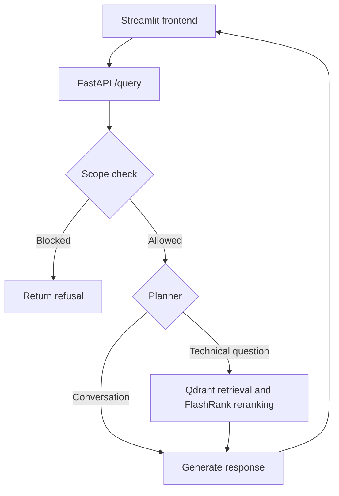

# Enterprise Agentic RAG

A document question-answering application for **Kubernetes, Intel hardware, and enterprise networking**, built with FastAPI, Streamlit, LangGraph, Qdrant, and a Portkey LLM gateway.

The application checks each question's topic before running the RAG workflow, retrieves and reranks document passages for technical questions, and displays the answer alongside retrieved context.

## Features

- **Topic filtering:** a Groq-powered scope classifier blocks unrelated or uncertain requests before retrieval.
- **Workflow orchestration:** LangGraph routes requests through a planner, optional retrieval, and response generation.
- **Conversation memory:** thread-based, in-process memory using LangGraph MemorySaver.
- **LLM gateway:** planner and responder calls use Portkey; routing, caching, and fallback behavior depend on the configured Portkey configuration.
- **Document retrieval:** Qdrant vector search with local FlashRank reranking.
- **Embeddings:** Gemini embeddings, with a local sentence-transformers fallback.
- **Document ingestion:** local parsers for PDF, HTML, TXT, DOCX, and PPTX.
- **Observability:** Logfire instrumentation and configurable LangSmith tracing.
- **API controls:** request validation and a 10-request-per-minute query limit per client IP.
- **Docker Compose:** separate backend and frontend containers started with one command.

## Request flow



The scope classifier calls Groq directly. Planner and responder calls go through Portkey. NeMo Guardrails configuration is included, but the current API gate uses the separate scope classifier.

## Technology

| Component | Technology |
|-----------|------------|
| Frontend | Streamlit |
| Backend | FastAPI, Pydantic |
| Orchestration | LangGraph, LangChain |
| Generation gateway | Portkey with Groq provider aliases |
| Scope classifier | Groq via ChatGroq |
| Vector database | Qdrant |
| Reranking | FlashRank |
| Embeddings | Gemini; local all-mpnet-base-v2 fallback |
| Observability | Logfire, LangSmith |
| Packaging | Docker, Docker Compose |

## Repository layout

| Path | Purpose |
|------|---------|
| `app/agents/` | Graph, state, planner, retriever, and responder |
| `app/gateway/` | Portkey clients and gateway configuration |
| `app/guardrails/` | Scope check and NeMo configuration |
| `app/ingestion/` | Document loaders, chunking, and indexing |
| `app/services/retrieval/` | Embeddings, vector search, and reranking |
| `app/main.py` | FastAPI endpoints and request validation |
| `ui/app.py` | Streamlit chat interface |
| `tests/` | Guardrail and query endpoint tests |
| `Dockerfile` | Backend container |
| `Dockerfile.ui` | Frontend container |
| `compose.yaml` | Runs both containers |
| `.dockerignore` | Excludes secrets and unnecessary build files |

Source documents in `DATA/` and generated files in `processed_data/` are excluded from Git. Supply your own documents before ingestion.

## Configuration

Create a `.env` file in the project root:

```env
# Required backend services
GROQ_API_KEY=
PORTKEY_API_KEY=
PORTKEY_CONFIG_SLUG=
QDRANT_API_KEY=
QDRANT_CLUSTER_ENDPOINT=
GEMINI_API_KEY=

# Local Streamlit connection; Compose overrides this inside its frontend
BACKEND_URL=http://127.0.0.1:8000

# Observability
LOGFIRE_TOKEN=
LANGSMITH_TRACING=false
LANGSMITH_ENDPOINT=https://api.smith.langchain.com
LANGSMITH_API_KEY=
LANGSMITH_PROJECT=enterprise-rag
```

Configure the Portkey provider aliases used by the code: `rag` for the primary target and `rag2` if using the fallback target. Supply a valid `PORTKEY_CONFIG_SLUG`; the clients reference this remote configuration.

Never commit `.env` or API keys. External services require your own accounts and may have usage limits or charges.

## Prepare the document index

Ingestion is a separate step from starting the containers. If you already have a populated, compatible Qdrant collection, you can reuse it.

For a new index, install the Python dependencies locally:

```powershell
python -m venv .venv
.\.venv\Scripts\Activate.ps1
python -m pip install -r requirements.txt
```

Place your documents in a `DATA` folder, then run:

```powershell
python -m app.ingestion.processor DATA
```

The processor parses documents, creates chunks, and indexes them in Qdrant. The configured collection name is `enterprise_rag`.

Use `--wipe` only when you intend to delete and recreate the collection:

```powershell
python -m app.ingestion.processor DATA --wipe
```

Use the same embedding model for indexing and querying. Gemini and the local fallback have different vector dimensions and cannot be used interchangeably against an existing index.

## Run with Docker Compose

### Prerequisites

- Docker Desktop running with Linux containers.
- A configured `.env` file.
- A populated Qdrant collection compatible with the active embedding model.

From the project root:

```powershell
docker compose up --build
```

The first build can take several minutes. Wait for the backend's `Application startup complete` message before submitting questions.

| Service | Address |
|---------|---------|
| Streamlit chatbot | http://localhost:8501 |
| FastAPI interactive API docs | http://localhost:8080/docs |
| Backend status | http://localhost:8080 |

Streamlit connects to `http://backend:8080` inside the Docker network. Your browser uses the localhost addresses above.

Docker Compose starts the application services locally. It does not publish a public website or provision the external APIs and Qdrant collection.

### Stop and restart

Press Ctrl+C, then remove the containers and Compose network:

```powershell
docker compose down
```

Start again:

```powershell
docker compose up
```

After changing code or dependencies, rebuild with `docker compose up --build`.

### Troubleshooting

| Symptom | What to check |
|---------|---------------|
| Docker Linux engine pipe error | Open Docker Desktop and wait for the engine to start. |
| Frontend reports backend offline | Check backend logs and wait for startup to complete. |
| Port already in use | Stop the other process using port 8501 or 8080. |
| Scope check unavailable or failed | Check Groq credentials, connectivity, and limits in backend logs. |
| Retrieval fails | Check Qdrant connectivity, collection contents, and embedding compatibility. |
| Generation fails | Check the Portkey key, configuration slug, provider aliases, and provider limits. |

View service logs:

```powershell
docker compose logs backend
docker compose logs frontend
```

## Run without Docker

Install the dependencies and configure `.env` as described above.

Start the backend in one terminal:

```powershell
.\.venv\Scripts\Activate.ps1
python -m uvicorn app.main:app --reload --port 8000
```

Start the frontend in a second terminal:

```powershell
.\.venv\Scripts\Activate.ps1
python -m streamlit run ui/app.py
```

For this setup, use `BACKEND_URL=http://127.0.0.1:8000`.

| Service | Address |
|---------|---------|
| Streamlit chatbot | http://localhost:8501 |
| FastAPI interactive API docs | http://127.0.0.1:8000/docs |

## Verify the application

| Test | Expected behavior |
|------|-------------------|
| “How to make coffee?” | Refusal; retrieval skipped |
| “What is Kubernetes?” | In-scope response |
| A specific question covered by indexed documents | Relevant answer and retrieved context available for inspection |

A successful response alone does not prove that the answer is supported by the documents. Inspect retrieved passages when assessing answer quality.

## Scope evaluation in GitHub Actions

The [RAG evaluations workflow](.github/workflows/rag-evals.yml) runs on pull requests and pushes to `main`. You can also run it manually from the Actions tab. Add `GROQ_API_KEY` as a repository secret under **Settings → Secrets and variables → Actions**.

The [pytest suite](tests/test_guardrails.py) sends nine questions to the live Groq scope classifier. It checks whether the classifier allows in-scope IT questions and blocks unrelated requests, mixed-topic requests, and attempts to override instructions. The job requires **100% scope accuracy (9/9)**. A wrong decision, a missing key in CI, or a provider error fails the check. This score measures the classifier's allow or block decisions before retrieval. Retrieval and generated answer quality require separate evaluations.

To run the same check locally in PowerShell, install the project dependencies and set `GROQ_API_KEY` in your terminal environment before running pytest.

```powershell
python -m pip install -r requirements.txt pytest
python -m pytest -q -s tests/test_guardrails.py
```

A passing run prints `Scope accuracy: 100.0% (9/9)`. In GitHub, find the score under **Actions → RAG evaluations → Scope evaluation → Run live scope evaluation**.

## Current limitations

- Conversation memory is held in the backend process and is lost on restart.
- The scope check is model-based and can misclassify requests.
- Retrieved context is displayed, but claim-by-claim citation verification is not implemented.
- The current app is a portfolio prototype; production use would require additional authentication, persistent state, and deployment hardening.
- Docker Compose uses startup ordering rather than a backend readiness health check.
